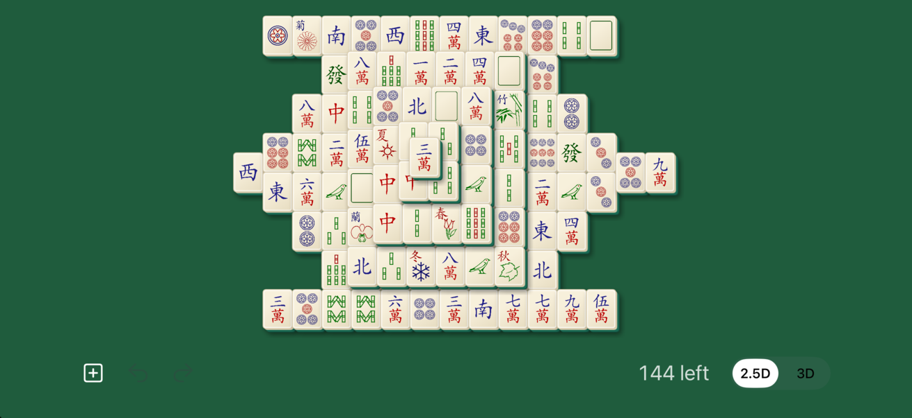
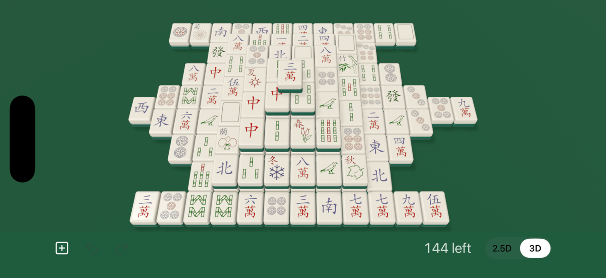
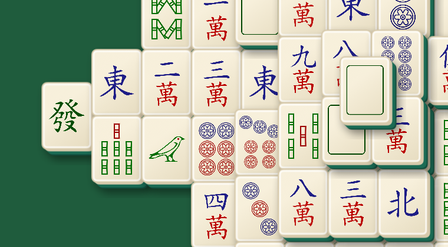
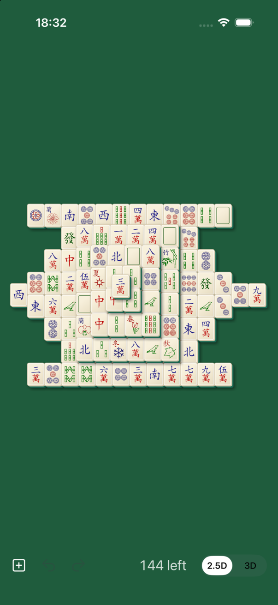
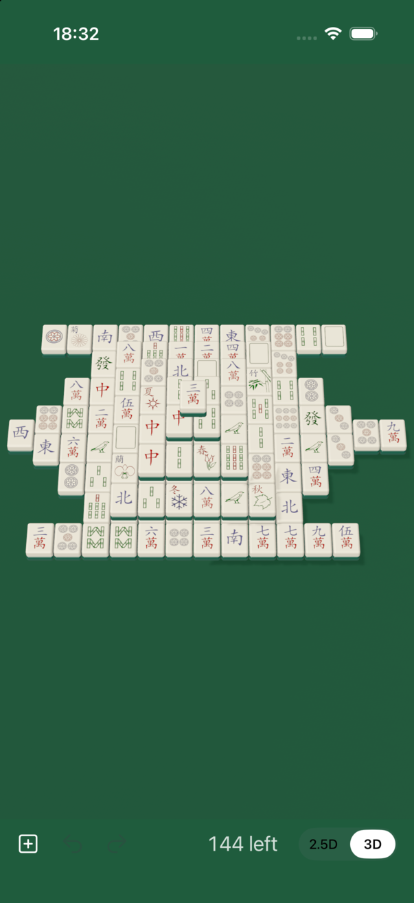
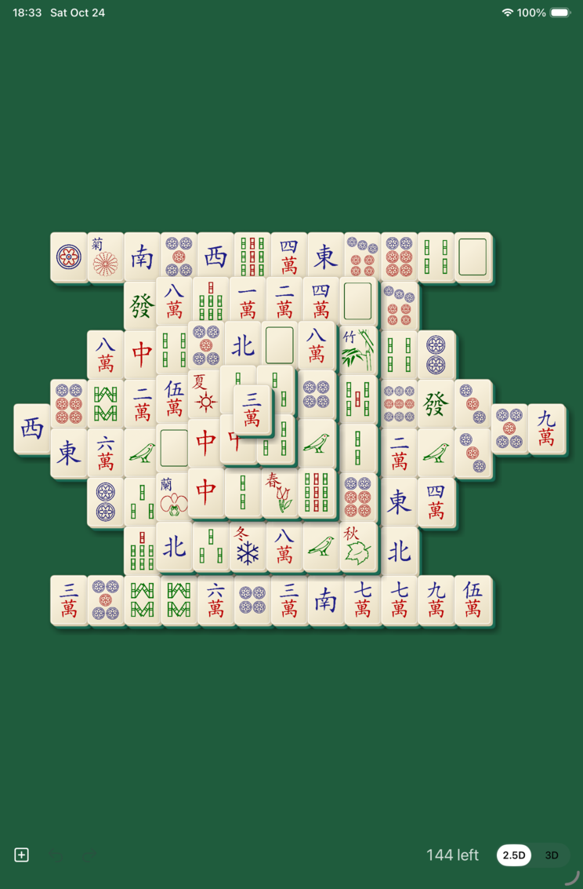
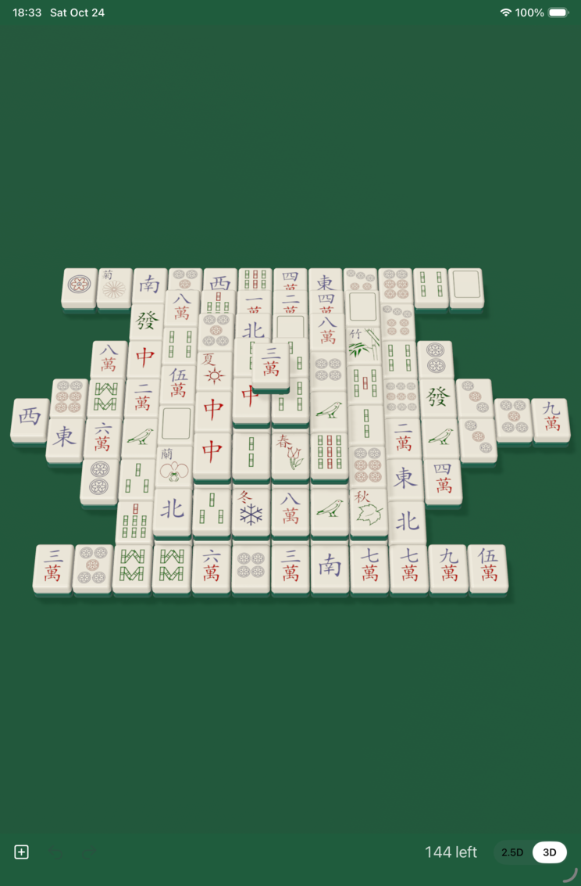

# Renderer spikes: 2.5D SpriteKit vs 3D RealityKit

Spikes for #11 and #12; the decision is #13. Both renderers are in the app now.
Use the **2.5D / 3D** switch in the toolbar to flip between them on a device.

Both use the same contract. They get an immutable `BoardState` (layout, faces,
which tiles remain, selection, shake requests) and report taps as tile indices.
Selection and matching live in `GameModel.tap(_:)`, and neither renderer knows
any game rules.

Screenshots are from the iPhone 17 Pro simulator and iPad mini simulator, all
showing deal 206662123.

## Side by side

| | 2.5D (SpriteKit) | 3D (RealityKit) |
|---|---|---|
| iPhone landscape |  |  |
| Close-up |  |  |
| iPhone portrait |  |  |
| iPad mini portrait |  |  |

Portrait iPhone is tiny in both. Fixing that is #14 (rotated board).

## 2.5D (SpriteKit): `App/SpriteBoard/`

- **Look:** each tile is one pre-rendered Core Graphics image (ivory top with a
  soft gradient and rim, extruded ivory-then-green sides toward the lower right,
  soft drop shadow) with the face art on top. Each layer shifts up-left by the
  tile thickness.
- **Legibility:** the best of the two. Faces are big and crisp, because the
  board uses the full rectangle with no perspective.
- **Stacking:** readable from the layer offset plus shadows. It's subtler than
  3D: you notice the stack edges more than the height.
- **Draw order:** sorted by `(z, x+y, x)`. I checked it on the risky spots: the
  half-offset end tiles and the peak all occlude correctly (see the close-up).
- **Hit-testing:** plain rectangle math in board coordinates, front-most tile
  wins, and a tile's visible sides count as part of it. Checked with a UI test
  tap on the left end tile.
- **Code:** about 340 lines.
- **Known gaps:**
  - Both visible sides use the same shading.
  - `SpriteView` redraws every frame even when nothing moves. To save battery
    it should pause while idle.
  - The tile textures are rebuilt whenever the view size changes, which is cheap
    so far.

## 3D (RealityKit): `App/RealityBoard/`

- **Look:** rounded boxes (ivory top half, green back half) on a felt plane,
  with one shadow-casting directional light plus a point fill light. The camera
  is fixed, tilted 34° from straight down, with a 28° field of view, and is
  framed by projecting every tile corner. The face art is a decal quad on top.
- **Stacking:** the clearest of the two. Height, real shadows on lower tiles and
  the visible green backs make the layers obvious at a glance.
- **Legibility:** worse.
  - Perspective shrinks the far rows.
  - Thin strokes come out paler, because the 512 px face textures are averaged
    down to about 40 pt (measured: the red ink matches the source exactly, but
    thin blue numerals wash out). Pre-scaled textures or sharper mip levels
    should fix it.
  - The face decals had to be *unlit* with tone mapping off. With lit PBR
    materials the ink came out badly desaturated.
- **Hit-testing:** collision boxes plus `SpatialTapGesture().targetedToAnyEntity()`,
  so RealityKit does the work. Checked with the same UI test tap.
- **Startup:** on the simulator the first launch showed an empty board for
  several seconds while textures and shaders loaded. On a device it needs at
  least a loading state.
- **Code:** about 280 lines.
- **Known gaps:**
  - Continuous rendering, same as 2.5D.
  - Lighting is hand-tuned by eye.
  - Removal and shake animations are simple `move(to:)` calls driven by tasks.

## Not measured

Frame rate and energy use need a real device: simulator GPU numbers mean
nothing. To compare:
- Run each mode on the oldest device you care about.
- Open Xcode's Debug navigator and watch the Energy Impact and FPS gauges while
  idle and while matching quickly.
- Watch for heat after 10 minutes of play.

## My take

2.5D is more legible and simpler. 3D shows stacking better and feels more like
real tiles, but needs more work for face clarity and startup time. If 3D feels
much nicer in the hand, its problems are fixable. Otherwise 2.5D is the safer
bet. Your call in #13, ideally after playing a few games with each.
